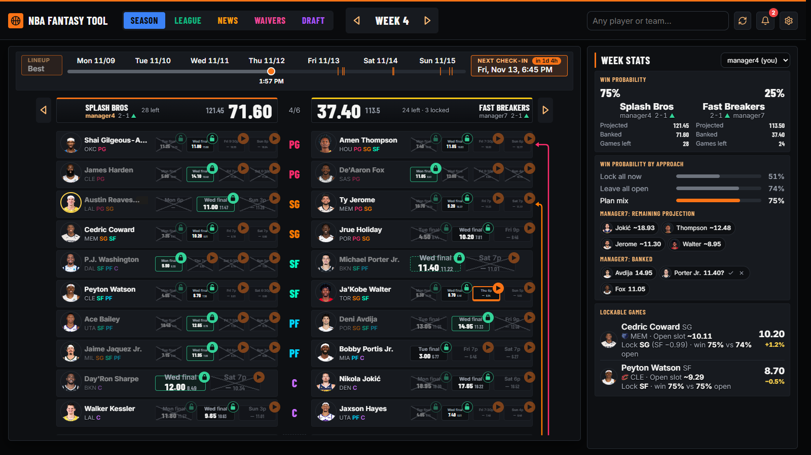

# NBA Fantasy Tool

[](https://github.com/sawyerpham/nba-fantasy-tool/actions/workflows/ci.yml)
[](LICENSE)


A full-stack assistant for Sleeper NBA fantasy leagues. Before the season it runs an auction-draft advisor. During the
season it runs a lineup engine for Sleeper's **Lock-In** format: at any minute of the week it shows the best lineup,
which finished games to lock, which bench player to swap in before the next tip, and how much each call changes the
chance of winning the matchup. It is used every week by a 12-team league and pushes its calls to Telegram.



*The Season tab: your best lineup against this week's opponent, every player's games with projections, scores and
padlocks, the arrows for the moves Sleeper still needs, and on the right the win probability under each strategy and
the games worth locking.*

## What it does

**In season (Lock-In leagues)**

- The best lineup for the current time of the week, re-planned on every request. A timeline slider replays the plan
  at any minute of the week, with ticks at the check-ins where a Sleeper visit is needed.
- Lock or wait calls for every finished game, each with the win chance locked and the win chance left open. The app
  shows both numbers and never dictates.
- Keep or swap calls while games are live: where a starter's game is headed versus the bench player tipping later.
- Injury watch (GTD / OUT) with the backup to start, the week's lockable games ranked by win-probability added, and the
  opponent's remaining projection and banked points.
- Live game cards from ESPN (score, box scores in league scoring, top performers, depth charts), player profiles with
  game logs and news, NBA team cards with records, ranks and schedules, the week's best games across the whole NBA,
  waiver targets with FAAB bids, league standings.
- Telegram pushes: each GTD / OUT / swap / lock call once at its alarm time, and the lineup moves due before a tip.

**Before the season (auction drafts)**

- Auction values and rankings from last season's game logs under the league's own scoring, with position scarcity and
  tier cliffs, keeper keep-or-cut verdicts, a budget plan for the open roster spots, and rival managers' money, needs
  and bidding habits from past Sleeper leagues.
- Live sync with the Sleeper draft room: a bid call on each nominee as it comes up.

## How it works

```
  React 19 + Vite  (frontend/src)             FastAPI, Python 3.13  (backend/app)          Outside
 ┌───────────────────────────────┐   /api   ┌───────────────────────────────────┐    ┌───────────────────┐
 │ Season · League · News        │ ───────▶ │ lockin/   week_view, team_plan    │ ─▶ │ Sleeper API       │
 │ Waivers · Draft · Settings    │ ◀─────── │           weekplan  (the engine)  │ ─▶ │ ESPN scoreboard   │
 │ three UIs, three themes       │          │ draft/    auction room, bid calls │ ─▶ │ stats.nba.com     │
 └───────────────────────────────┘          │ core/     league session, pull    │    └───────────────────┘
                                            │ notify    Telegram watcher thread │ ─▶   Telegram
                                            └─────────────────┬─────────────────┘
                                                              │
                                            ┌─────────────────▼─────────────────┐
                                            │ shared/nba_fantasy_shared         │
                                            │ models · providers · reconcile    │
                                            │ scoring · JSON store              │
                                            └───────────────────────────────────┘
```

- **Backend:** FastAPI, everything under `/api`. One `AppState` per process holds the providers, the player pool and
  the open league sessions. Persistence is flat JSON under `backend/data/`; there is no database. The same process
  serves the built frontend, so one container runs the whole app.
- **Frontend:** React 19 with Vite, plain JSX, no UI library. Three interchangeable UIs (default, Command Center,
  Broadcast) share the same data hooks and cards; three design presets are pure CSS tokens.
- **Shared package:** the data models (Pydantic), the Sleeper / nba_api / fixture providers, name reconciliation, the
  scoring formula and the JSON store, installed editable into the backend.
- **Data:** Sleeper (rosters, matchups, per-game projections, box scores, injuries, news, transactions), ESPN (tip
  times, live status, game summaries) and nba_api (game logs for valuations). Every fetch goes through one per-URL
  cache with a TTL by volatility: 90 s on game days, 30 min for projections, 6 h for schedules. A week's requests are
  prefetched in parallel.

## The interesting problems

**Lock or wait, decided by win probability.** In Lock-In each starting slot scores exactly one game a week: the game
you lock, or else the slot's last game. Locking a finished game is final; waiting risks a worse last game. For each
starter the engine compares *X*, his finished game, with *W*, the value of his remaining games played optimally,
computed backwards from his last game:

    V_last = p · μ_last
    V_k    = p · E[max(X_k, V_k+1)] + (1 − p) · V_k+1,     X_k ~ Normal(μ_k, μ_k · swing)

where *p* is his chance to play (from his injury tag, back-to-backs and age), *μ* is Sleeper's projection scaled by
0.925 (it runs high) and *swing* is one game's spread as a share of its mean: his own game-to-game variation pulled
toward the league's 0.45. The same recursion carries the second moment, so every open slot has its real variance:
a questionable player's 60 % of a 20 is far less certain than a healthy player's 12. The call is not "which is
bigger" but which gives the higher chance to win the matchup: the week's totals are summed and
P(win) = Φ(Δ / √(σ²<sub>me</sub> + σ²<sub>opp</sub>)), with the deciding slot's chance of scoring nothing counted
apart from the bell curve. Both chances are shown on every card (`weekplan.py: wait_moments, decide_by_win_chance`).

**Seating a lineup under multi-position eligibility.** Slots are PG PG SG SG SF SF PF PF C C and most players fit
two or three. Seating highest value first and sliding already-seated players along augmenting paths is optimal here
(the slots form a transversal matroid), and it is what puts a PG/SG's lock in the SG slot when two better PGs still
have games (`seat_players`).

**A week as a timeline of check-ins.** Sleeper can only be changed by hand, so the lineup changes only at check-ins
15 minutes before a tip where someone moves in, and every swap available at that moment is made at once: one visit
per slate rather than one per game. Each check-in replans the day from the previous one's lineup. The slider replays
the result at any minute, and the arrows on the cards are the exact moves to make in Sleeper, in a legal order
(`week_timeline`, `swaps.js`).

**Keep or swap on a live score.** Where a game in progress will finish: points so far plus a rate times the minutes
left, with the rate shrunk toward the pregame projection as if he had played `PRIOR_MINUTES` more at it, so a hot or
cold first quarter does not swing the call. The two constants were fit by replaying this season's finished games at
fixed points on the game clock (`backtest_live.py`; numbers below).

**One player, three sources.** nba_api, Sleeper and ESPN each have their own ids and spellings. A five-stage
reconciliation matches on normalized name and team, then unique name, then birthdate, then nba_api's static list;
nothing is dropped silently and every non-trivial match lands in a report shown in Settings.

**Working with Sleeper as it is.** The multi-megabyte player file may be fetched once a day, so it sits behind an
on-disk guard that is never bypassed at startup. Sleeper serves one lineup day at a time and flips to the next in the early
morning, so the app knows when the lineup it reads is yesterday's. Whether a rival locked a game is inferred by
comparing Sleeper's counted points with the box scores, and a finished week takes Sleeper's final count over any
saved answer.

## Measured

The live finish estimate was backtested by replaying every finished game of the 2026-27 season so far (Oct 20 to
Nov 11: **2,843 player games, 11,296 checkpoints** at the end of Q1, halftime, end of Q3 and mid-Q4), for rotation
players projected for 15+ minutes. Error is in league fantasy points, where a typical starter's game is 8 to 15 FP.

| Estimate at                     | end of Q1 | halftime | end of Q3 | mid-Q4 |
|---------------------------------|----------:|---------:|----------:|-------:|
| naive: tonight's rate continues | 3.46      | 2.14     | 1.36      | 0.90   |
| **shipped: rate shrunk toward the projection** | **2.28** | **1.84** | **1.33** | **0.91** |
| pregame projection's rate alone | 2.27      | 1.84     | 1.34      | 0.92   |

Mean absolute error of the predicted final; bias is within 0.15 FP at every checkpoint, and the predicted minutes
left are within about a minute of the actual at each checkpoint. Two findings worth knowing: shrinking the live rate
cuts the first-quarter error by a third against naive extrapolation, and a player's live rate adds almost nothing
over his projection on average, so the engine leans on the projection and lets the actual score, not the rate, move
the keep-or-swap call. The miss shrinks with the square root of the share of the game left (0.87 / 0.70 / 0.51 /
0.36 of the pregame miss at those four checkpoints, against √share = 0.87 / 0.71 / 0.50 / 0.35), which is how a live
game's spread is modelled. Reproduce with `python -m app.lockin.backtest_live` from `backend`.

The week plan's inputs were fit on the first three weeks (**2,048 played games, 882 player weeks, 18 matchups**),
replayed from Sleeper's own history. Reproduce with `python -m app.lockin.backtest_week` from `backend`.

| Check                                                        | before | now  | calibrated |
|--------------------------------------------------------------|-------:|-----:|-----------:|
| actual FP ÷ the plan's mean for a game                       | 0.926  | 1.00 | 1.00       |
| actual one-game spread ÷ the plan's                          | 2.13   | 1.02 | 1.00       |
| lock rule replayed: FP banked vs the wait value promised     | 8.58 vs 8.55 | 8.57 vs 8.71 | equal |
| lock rule replayed: miss ÷ the plan's spread for the slot    | n/a    | 1.07 | 1.00       |
| Monday win chance, Brier score (0.25 = coin flip)            | 0.246  | 0.247 | lower     |
| real matchup margin ÷ the plan's spread for it               | 1.39   | 1.25 | 1.00       |

The game-level numbers are solid; 18 matchups are too few to judge the win chance itself (its Brier score moves by
about 0.03 from sample noise alone), and real margins still run wider than the plan expects.

## Testing and CI

- 302 backend tests (`pytest`) run offline against captured real API responses under `backend/tests/fixtures`:
  the engine, the API, reconciliation, scoring, the week plan and the Telegram watcher.
- `frontend/src/lockin/swaps.check.mjs` replays every lineup swap the UI can propose and asserts each step is legal.
- Playwright end-to-end scripts in `frontend/e2e`: a mock auction draft driven entirely through the browser, and
  screenshot / computed-style diffs for CSS refactors.
- GitHub Actions runs `ruff`, the test suite, the swap checks, the production build and the Docker build on every push.

## Run it

### Docker

```sh
docker compose run --rm app python -m app.pull   # first time only: NBA game logs and the Sleeper player file (a few minutes)
docker compose up --build                         # then open http://localhost:8000
```

Pulled data lives in `backend/data/`, which the container mounts, so Docker and local runs share it.

### Local

Needs Python 3.13 and Node 20+.

```sh
cd backend
python -m venv venv
./venv/bin/python -m pip install -r requirements.txt     # Windows: .\venv\Scripts\python.exe
./venv/bin/python -m app.pull
./venv/bin/python -m app.serve --port 8000
```

In another terminal:

```sh
cd frontend
npm install
npm run dev          # http://localhost:5173, proxies /api to the backend
```

Then create a league, enter your Sleeper league id in Settings and pick which manager you are. On Windows,
`start.ps1` runs both servers hidden and opens the browser; `stop.ps1` stops them.

Checks: `python -m pytest -q tests` and `ruff check` for the backend, `node src/lockin/swaps.check.mjs` and
`npm run build` for the frontend.

### Telegram notifications (optional)

1. In Telegram, message @BotFather, send `/newbot` and copy the token. Message your new bot once, then open
   `https://api.telegram.org/bot<TOKEN>/getUpdates` and copy `chat.id`.
2. Create `backend/.env` (gitignored):
   ```
   TELEGRAM_BOT_TOKEN=123456:ABC-your-token
   TELEGRAM_CHAT_ID=123456789
   ```
3. Test with `python -m app.notify "hello"` from `backend`, then restart the server. The watcher polls every minute
   while the backend runs and logs to `backend/data/cache/notify.log`.

The home page and Settings > Notifications show which chat the bot is linked to, with a link to it. The same section
picks what to push (lock calls, keep / swap calls, players ruled OUT, GTD / DTD or cleared, lineup moves) and the win
chance a lock call must add before it is pushed.

## Repository layout

```
backend/app/
  core/      api/ (leagues, players, data pull)   engine/ (session, ranking, bidding, budget, roster, keepers)
             services/ (app state, pull, valuations, Sleeper league link and changelog)
  draft/     auction routes, fit, market, room
  lockin/    api, service (week view, plans, game and team cards), weekplan (the engine), backtest_live, backtest_week
  main.py    notify.py (Telegram)   pull.py / valuate.py (CLIs)
backend/tests/      pytest suite; fixtures/ holds captured API responses
frontend/src/
  core/      shell, settings, player sidebar and search, shared widgets
  draft/     the Draft tab          lockin/   the Season tabs, swaps.js, time zone helpers
  ui-command/ ui-broadcast/         the two alternative UIs
shared/nba_fantasy_shared/   models, providers, reconcile, scoring, storage
```

## Scope

Sleeper leagues only. The Season tab supports the Lock-In format; the Draft tab supports auction drafts. The app is
single-user with no login: it is meant to run on your own machine or a private container. Projections and news come
from Sleeper's feeds; stats.nba.com throttles aggressively and blocks some cloud networks, so the first data pull is
best run from a home connection.

## License

[MIT](LICENSE)
